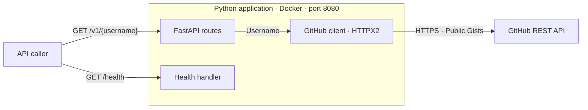
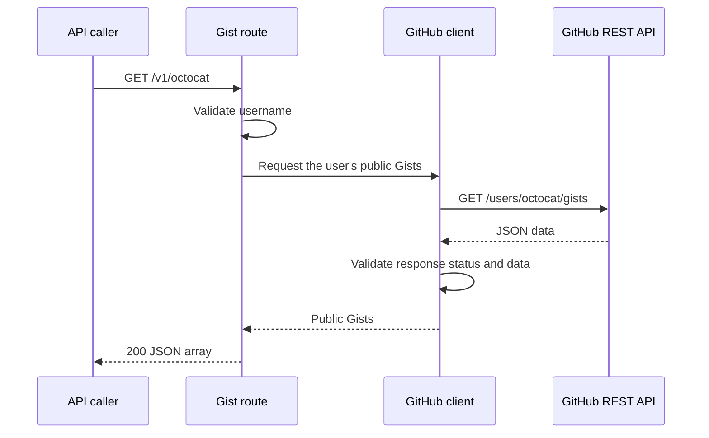

# GitHub API design

## 1. Overview

This service lists a GitHub user's public Gists through a small Python API. It accepts a username, calls GitHub, and returns the results as JSON. The application runs in Docker on port `8080`.

## 2. Project scope

The [original requirements](../README.md#original-readme) define the project brief. The [plan](plan.md) describes the implementation order; this document explains the design and trade-offs.

| Category | Scope |
| --- | --- |
| Required features | Public Gist retrieval, automated tests, Docker packaging on port `8080`, and run instructions |
| Development setup | A reusable VS Code Dev Container with Python, dependencies, debugging, and test tools |
| Optional features | Health is implemented. Pagination and navigation links, caching, a CI/CD pipeline, and a frontend remain optional future work. |

The detailed security boundaries are listed under [Security and operation](#10-security-and-operation).

## 3. System architecture

The API fetches public Gists from GitHub and returns them to the caller.




### Component responsibilities

- At startup, the app loads settings, configures logging, and creates a shared HTTP client. At shutdown, it closes the client.
- The API validates incoming requests and converts GitHub failures into HTTP error responses.
- A GitHub client retrieves public Gists and validates the returned data.
- The health endpoint confirms that the application is responding.


Future API versions can use separate routers and share the GitHub client.

## 4. API design

- `GET /v1/{username}` returns public Gists as a JSON array.
- Gist fields are returned as provided by GitHub.
- `/v1` allows future API versions. The root-level `/{username}` path is not supported.
- Optional: `GET /health` confirms that the application is responding.

See the [README](../README.md#use-the-api) for usage and error responses.

## 5. Request flows

### Retrieving Gists



## 6. Errors

GitHub failures will be mapped to HTTP errors. Requests will not be retried automatically.

See the [README error table](../README.md#use-the-api) for status codes.

## 7. Optional features

### Health check (implemented)

The health endpoint will confirm that the application is responding.

### Pagination (not implemented)

The proposed extension would let callers request one page at a time:

```http
GET /v1/octocat?page=2&per_page=30
```

| Parameter | Default | Accepted values |
| --- | --- | --- |
| `page` | `1` | Positive integer |
| `per_page` | `30` | Integer from `1` to `100` |

Invalid or repeated pagination parameters return `400`. The body stays a JSON array. Navigation is provided through the `Link` response header:

```http
Link: </v1/octocat?page=1&per_page=30>; rel="prev", </v1/octocat?page=3&per_page=30>; rel="next"
```

The GitHub client will send the requested `page` and `per_page` to GitHub. The API will use GitHub's validated pagination links to build local `next`/`prev` links, preserving the username and page size. Following a link repeats this flow for that page.

The `Link` header will be omitted when neither link is available.

## 8. Technology and design decisions

### Technology choices

| Component | Choice | Why I'm using it |
| --- | --- | --- |
| Language | Python | It's the language I'm most comfortable reading and writing. |
| API framework | FastAPI | It provides routing, validation, and JSON responses with little setup. Async support can be useful while waiting for GitHub. |
| Server | Uvicorn | It runs FastAPI through ASGI and works for development and the runtime container. |
| HTTP client | HTTPX2 | It supports connection reuse, timeouts, and mocked HTTP responses in tests. |
| Tests | pytest | I've used it before and like its fixtures and parameterised tests. |
| Dependencies | uv, `pyproject.toml`, and `uv.lock` | I prefer uv for its speed, dependency and environment management.|
| Formatting and linting | Ruff | One tool handles both jobs. |
| Logging | Python's standard library | Plain-text messages on standard output are enough. |
| Development | VS Code Dev Container | It provides a shared Python and editor setup without interfeatring with the host. |
| Packaging | Docker | It meets the requirement and lets user run the app without installing any Python dependencies.|

### Decisions and trade-offs

| Decision | Reason and trade-off |
| --- | --- |
| Separate GitHub client | Makes GitHub calls independently testable without adding unnecessary layers. |
| JSON array of Gists | Keeps the response simple and preserves GitHub's fields. |
| Health check (optional) | Gives container tooling a simple way to check whether the app is responding. |
| Pagination (optional) | `Link` headers keep the body unchanged; clients must read them to find more pages. |
| No database | No local storage to manage; requests depend on GitHub's availability. |
| Shared HTTP client | Reuses connections; the app must manage its startup and shutdown. |
| No automatic retries | Avoids additional waits and GitHub calls; callers decide whether to retry. |
| Caching (optional) | Could reduce GitHub calls, but adds stale data and cache-expiry decisions. |

## 9. Logging

- Logs will use plain text on standard output, with a timestamp, level, module, and message.
- Startup and shutdown will use `INFO`; GitHub `4xx` failures will use `WARNING`.
- GitHub `5xx` failures, timeouts, network errors, and invalid responses will use `ERROR`.
- Failure details will be limited to status codes and exception types.
- `LOG_LEVEL` will control application logs. Uvicorn will handle access logs.

## 10. Security and operation

### In scope

- Validate usernames before building upstream request paths.
- Use HTTPS with certificate verification for outbound GitHub requests.
- Reject invalid configuration during startup.
- Keep failure logs and public error responses free of upstream payloads and credentials.
- Run the runtime container as a non-root user to limit its privileges.
- Validate pagination parameters if pagination is implemented.

### Out of scope

- Caller authentication and authorisation
- Incoming API rate limiting
- Automatic retries for GitHub rate limits
- HTTPS termination for incoming traffic

### Configuration validation

Validate configuration before starting the server: require an HTTPS base URL, a finite positive timeout, and a supported log level.

See the [README](../README.md#configuration) for settings and defaults.

## 11. Development and testing

See the [developer guide](development.md) for environment setup, test organisation, fixtures, coverage, and code checks. The [plan](plan.md#steps) describes the test-first implementation approach.

## 12. Risks

| Item | Implication |
| --- | --- |
| GitHub availability and quotas | Requests can fail even when our app is healthy. Timeouts and clear errors help callers, but there is no retry mechanism or incoming rate limiter in this version. |
| Changing data between pages | Gists may be added, removed, or updated while a client navigates. Pages do not represent a fixed snapshot. |
| Optional caching | Choose a freshness period and cache keys covering username and pagination before adding it. Process-local caching would not be shared between instances. |
| Optional frontend | A frontend on another origin would need CORS configured to expose `Link`. Gist descriptions and filenames would be displayed as untrusted text. |

## References

- [Original README](../README.md#original-readme)
- [Project plan](plan.md)
- [GitHub Gists API](https://docs.github.com/en/rest/gists/gists#list-gists-for-a-user)
- [GitHub pagination](https://docs.github.com/en/rest/using-the-rest-api/using-pagination-in-the-rest-api)
- [FastAPI testing](https://fastapi.tiangolo.com/tutorial/testing/)
- [HTTPX2 timeouts](https://pydantic.dev/docs/httpx2/advanced/timeouts/)
- [VS Code Dev Containers](https://code.visualstudio.com/docs/devcontainers/containers)
- [The Twelve-Factor App](https://12factor.net/)
- [GitLab design document template](https://handbook.gitlab.com/handbook/engineering/architecture/design-documents/_template/)
- [arc42 template](https://arc42.org/overview/)
