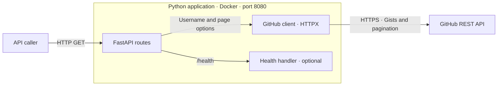
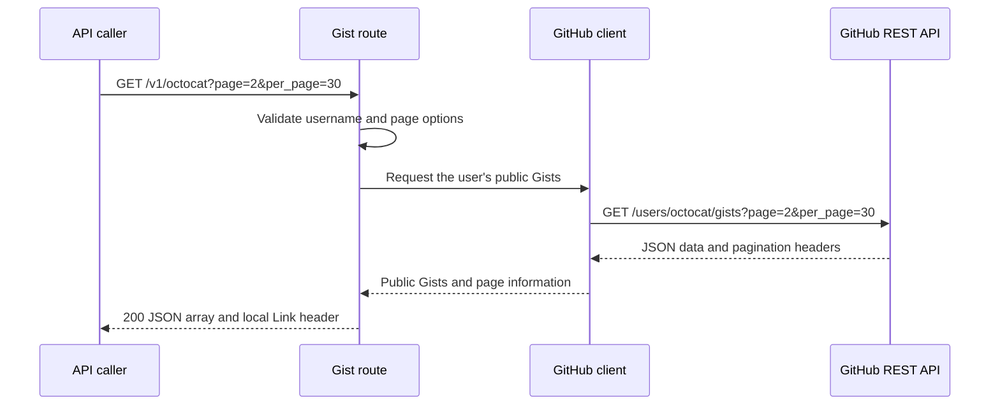

# GitHub API design

## 1. Overview

This service lists a GitHub user's public Gists through a small Python API. It accepts a username, calls GitHub, and returns the results as JSON. The application runs in Docker on port `8080`.

## 2. Goals, scope, and constraints

The [original requirements](../README.md#original-readme) ask for:

- a public Gists API
- an automated test
- a Dockerfile
- clear setup instructions

| Priority | Scope |
| --- | --- |
| Required | Public Gist retrieval, automated tests, Docker packaging on port `8080`, and run instructions |
| Development setup | A reusable VS Code Dev Container with Python, dependencies, debugging, and test tools |
| Optional, if time permits | Health, pagination and navigation links, caching, a CI/CD pipeline, and a simple frontend |
| Outside of scope | Caller authentication and authorisation, incoming API rate limiting, automatic retries for GitHub rate limits, and HTTPS termination for incoming traffic |


## 3. System architecture

The application sits between an API caller and GitHub. GitHub owns the Gist data; this service retrieves it and exposes it through its own HTTP interface.



The routes handle request validation and HTTP responses. The GitHub client handles outbound requests, upstream data, and integration errors. Health is a local check and has no dependency on GitHub.

The app keeps no persistent local data. Caching, if added later, would be a separate decision because it introduces state and a freshness policy.

### Code organisation

```text
app/
  main.py          # Application setup, health, and router registration
  routes.py        # Versioned Gist routes
  github.py        # GitHub requests and response handling
  config.py        # Environment settings
tests/
  conftest.py      # Shared settings fixture
  unit/
    config/
      conftest.py  # Isolated environment and temporary working directory
      test_get_github_base_url.py
      test_validate_github_base_url.py
      test_get_github_timeout_seconds.py
      test_validate_github_timeout_seconds.py
    github/
      conftest.py  # Mocked HTTP client, responses, and captured requests
      test_list_public_gists.py
  integration/    # Tests grouped by feature as they are added
```

This gives the code clear responsibility boundaries, following clean-architecture principles without introducing layers that have no work to do. The GitHub client does not depend on FastAPI. It returns Python data or raises an integration error, which the route translates into an HTTP response.

Keeping the routes in their own module makes the `/v1` prefix easy to register. A future version can have a separate router while sharing the GitHub client where the behaviour is unchanged.

## 4. API and data design

### Routes

| Method | Path | Purpose |
| --- | --- | --- |
| `GET` | `/v1/{username}` | Return a JSON array of the user's public Gists |
| `GET` | `/health` | Optional local health check returning `{"status":"ok"}` |

The versioned path is the project's only Gist endpoint. This is an intentional change from `/{username}` in the original requirements; there will be no compatibility alias. Root-level username requests return `404`. Keeping `/v1` in the path leaves room for a future API version without changing existing clients' URLs.

### Gist response

The response retains GitHub's existing Gist fields. An empty result returns `200` with `[]`; an empty list alone does not establish that the account is missing.

Calls to GitHub use anonymous access. The app will not accept, configure, or send a GitHub API token, and only public Gists are returned.

### Pagination

If pagination is included, callers can request one page at a time:

```http
GET /v1/octocat?page=2&per_page=30
```

| Parameter | Default | Accepted values |
| --- | --- | --- |
| `page` | `1` | Positive integer |
| `per_page` | `30` | Integer from `1` to `100` |

Invalid or repeated pagination parameters return `400`. The body stays a JSON array. Navigation is provided through the `Link` response header:

```http
Link: </v1/octocat?page=1&per_page=30>; rel="prev", </v1/octocat?page=3&per_page=30>; rel="next"
```

These links come from GitHub's pagination metadata and are rewritten to point to our API. They retain the username and page size. Upstream link targets are checked before local URLs are built.

A client can show a Next button when `rel="next"` exists, or follow next links until none remain. On the final page there is no next relation. If neither direction is available, the response has no `Link` header. A full page is not enough evidence that another page exists.

This version does not calculate total counts, add first/last links, or fetch every page automatically.

### Errors

Errors use JSON, for example `{"detail":"GitHub request timed out"}`.

| Problem | Response |
| --- | --- |
| Invalid username or pagination input | `400` |
| Unknown route, or GitHub explicitly reports user not found | `404` |
| Unsupported HTTP method | `405` |
| Recognised GitHub rate limit | `503` |
| GitHub request timed out | `504` |
| Other GitHub HTTP/network failure or invalid response data | `502` |

Reporting a GitHub rate limit is different from retrying it. The app returns an error and passes on a valid upstream `Retry-After` when available; automatic retries are outside scope. Incoming API rate limiting is also outside scope, so this design does not add a local `429` response.

## 5. Request flows

### Retrieving a page of Gists



For the next page, the caller follows the returned link. That creates another request through the same flow; the server does not collect all pages in the background.

### Checking health

The optional `/health` route returns `200` immediately without making a GitHub request. A GitHub outage therefore affects Gist retrieval, but not the local health response.

## 6. Technology and design decisions

### Technology choices

| Component | Choice | Why I'm using it |
| --- | --- | --- |
| Language | Python | It's the language I'm most comfortable reading and writing. |
| API framework | FastAPI | It provides routing, validation, and JSON responses with little setup. Async support is useful while waiting for GitHub. |
| Server | Uvicorn | It runs FastAPI through ASGI and works for development and the runtime container. |
| HTTP client | HTTPX | It supports connection reuse, timeouts, and mocked HTTP responses in tests. |
| Tests | pytest | I've used it before and like its fixtures and parameterised tests. |
| Dependencies | uv, `pyproject.toml`, and `uv.lock` | I prefer uv for its speed and dependency/environment management. The lockfile records the versions used by the project. |
| Formatting and linting | Ruff | One tool handles both jobs, so there is less to configure. |
| Development | VS Code Dev Container | It provides a shared Python and editor setup without changing the host Python installation. |
| Packaging | Docker | It meets the brief and lets reviewers run the app without installing its Python dependencies globally. |

### Decisions and trade-offs

| Decision | Reason and trade-off |
| --- | --- |
| A small app with a separate GitHub client | This is enough separation to test the integration independently. A larger domain/service structure would add little while the app mainly retrieves and returns data. |
| A JSON array with pagination links in headers | This preserves the list response and lets clients choose which pages to fetch. Clients need to read the `Link` header to discover more results. |
| No database | GitHub is the source of the data and this version does not store it. Each Gist request depends on GitHub being available. |
| One shared HTTPX client | Reusing connections avoids creating a client for each request. Startup and shutdown own its lifecycle. |
| No automatic retries | Response times and upstream call counts stay easier to understand. Callers may need to retry failed requests themselves. |
| Caching left as optional | It could save GitHub requests, but introduces stale data and cache-lifecycle decisions. |

## 7. Security and operation

Caller authentication, authorisation, incoming API rate limiting, and HTTPS termination for incoming traffic are outside this project's scope. Basic protections remain part of the design.

Basic handling still matters: usernames and page options are validated, outbound URLs stay restricted to GitHub, and HTTPS certificate verification remains enabled for GitHub calls.

| Environment variable | Default | Purpose |
| --- | --- | --- |
| `GITHUB_TIMEOUT_SECONDS` | `5` | Timeout in seconds for individual HTTP operations |

The timeout setting must be a finite, positive number. The default is five seconds for operations such as connecting or waiting for data; it is not a five-second deadline for the entire request. Invalid configuration stops startup with a useful error.

The app listens on `0.0.0.0:8080`. Logs go to standard output and include request status, duration, and errors, without exposing Gist contents. Shutdown closes the shared HTTPX client.

## 8. Development, deployment, and testing

The Dev Container includes Python, uv, debugging, pytest, coverage tooling, and Ruff. The runtime image uses the same pinned Python version and locked runtime dependencies, with development tools left out. It runs as a non-root user with minimal privileges and includes the certificates needed for GitHub HTTPS calls.

The deployment is one application container exposing port `8080` and making outbound HTTPS calls to GitHub. No database, queue, or additional service is needed. Exact setup and run commands belong in the README.

Tests are written before the implementation of each behaviour, as described in the plan. Most use mocked GitHub responses at the HTTP transport boundary, so the real application and client code can run without internet access.

| Area | Examples |
| --- | --- |
| Gist retrieval | Public results, empty arrays, and correct anonymous GitHub requests |
| Error handling | Invalid input, unsupported methods, unknown routes, upstream failures, rate limits, and timeouts |
| Pagination, if included | Defaults, invalid values, first/middle/final pages, empty pages, and local navigation links |
| Health, if included | Success without a GitHub call, including during a simulated upstream failure |

The coverage target is at least 85%, alongside assertions about actual behaviour. Coverage helps identify untested code; the percentage alone does not prove the app is correct.

A separate live check builds and runs the image, then requests Gists for `octocat`. It checks the returned structure without relying on fixed Gist IDs or assuming that octocat always has another page.

## 9. Risks

| Item | Implication |
| --- | --- |
| GitHub availability and quotas | Requests can fail even when our app is healthy. Timeouts and clear errors help callers, but there is no retry mechanism or incoming rate limiter in this version. |
| Changing data between pages | Gists may be added, removed, or updated while a client navigates. Pages do not represent a fixed snapshot. |
| Optional caching | Choose a freshness period and cache keys covering username and pagination before adding it. Process-local caching would not be shared between instances. |
| Optional frontend | A frontend on another origin would need CORS configured to expose `Link`. Gist descriptions and filenames would be displayed as untrusted text. |

## References

- [Original README](../README.md#original-readme)
- [Project plan](plan.md)
- [GitHub Gists API](https://docs.github.com/en/rest/gists/gists#list-gists-for-a-user)
- [GitHub pagination](https://docs.github.com/en/rest/using-the-rest-api/using-pagination-in-the-rest-api)
- [FastAPI testing](https://fastapi.tiangolo.com/tutorial/testing/)
- [HTTPX timeouts](https://www.python-httpx.org/advanced/timeouts/)
- [VS Code Dev Containers](https://code.visualstudio.com/docs/devcontainers/containers)
- [The Twelve-Factor App](https://12factor.net/)
- [GitLab design document template](https://handbook.gitlab.com/handbook/engineering/architecture/design-documents/_template/)
- [arc42 template](https://arc42.org/overview/)
